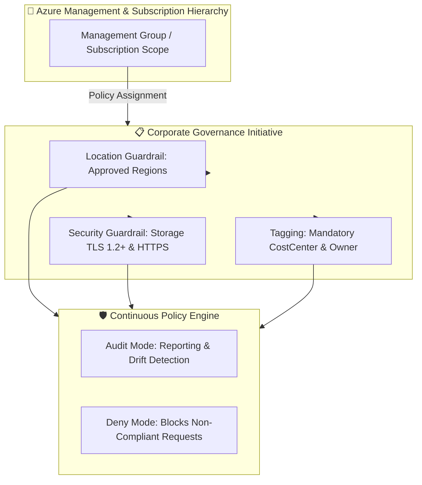

# Azure Governance Landing Zone (Terraform)

[](https://github.com/sanjiivsingh/azure-landing-zone-governance/actions)
[](https://opensource.org/licenses/MIT)

An enterprise-grade, modular Terraform landing zone implementation providing **Azure Policy guardrails**, **naming & tagging standards**, and **security initiatives** aligned with the **Microsoft Cloud Adoption Framework (CAF)**.

---

## 🏛️ Architecture Overview



---

## 🌟 Key Features
- **Region Sovereignty Guardrails:** Restricts provisioning to authorized Azure regions (e.g., `eastus2`, `centralus`) to enforce data sovereignty.
- **Data Protection Enforcement:** Denies storage account creation allowing HTTP plain-text or TLS versions below 1.2.
- **Automated Tag Governance:** Custom policy definitions to mandate or inherit enterprise tags (`Environment`, `CostCenter`, `Owner`).
- **Initiative Bundling:** Pre-packages policies into a single version-controlled Policy Set (Initiative).
- **Safe Rollout Strategy:** Configurable audit vs. deny enforcement modes for zero-downtime adoption.

---

## 📁 Repository Structure
```text
azure-landing-zone-governance/
├── README.md
├── LICENSE
├── CONTRIBUTING.md
├── SECURITY.md
├── CHANGELOG.md
├── docs/                      # Architectural & operational documentation
├── diagrams/                  # Mermaid diagram source definitions
├── modules/
│   ├── naming_tagging/        # Tag enforcement & inheritance policies
│   ├── guardrails/            # Location & storage encryption policies
│   └── initiatives/           # Custom policy set bundle
└── environments/
    └── dev/                   # Dev environment deployment configuration
```

---

## 🚀 Quick Start Deployment

### Prerequisites
- Terraform `>= 1.9.0`
- Azure CLI authenticated with `Owner` or `Resource Policy Contributor` role.

### Deploying the Dev Environment
```bash
cd environments/dev

# Copy example configurations
cp terraform.tfvars.example terraform.tfvars

# Initialize without remote backend for testing
terraform init

# Validate configuration
terraform validate

# Plan and Review
terraform plan

# Apply Governance Controls
terraform apply
```

---

## 🛡️ DevSecOps & Validation
This repository includes automated CI/CD validation:
- **TFLint & Terraform Validate:** Validates syntax and provider configurations on every pull request.
- **Checkov SAST:** Scans for compliance drift and CIS Azure benchmark alignment.
- **Azure DevOps Pipeline:** Pre-configured YAML pipeline template under `pipelines/azure-devops/validation.yml`.

---

## 📄 License
This project is open-source under the [MIT License](LICENSE).
